# Mac Skin para Windows

Deixa o Windows com cara de macOS **sem precisar de admin**. Tudo é aplicado só no usuário atual (HKCU e `%LOCALAPPDATA%`), e o desinstalador devolve exatamente o que havia antes.

## O que faz

- Barra de tarefas centralizada, destaque azul `#007AFF`, transparência, desktop limpo
- Modo claro às 07h e escuro às 19h, com o papel de parede Sonoma claro/escuro
- Cursores do macOS ([apple_cursor](https://github.com/ful1e5/apple_cursor), GPL-3.0)
- Ícones da Apple na Lixeira, Este Computador, pastas do usuário e atalhos da barra e do Iniciar
- Fonte [Inter](https://rsms.me/inter/) (OFL)

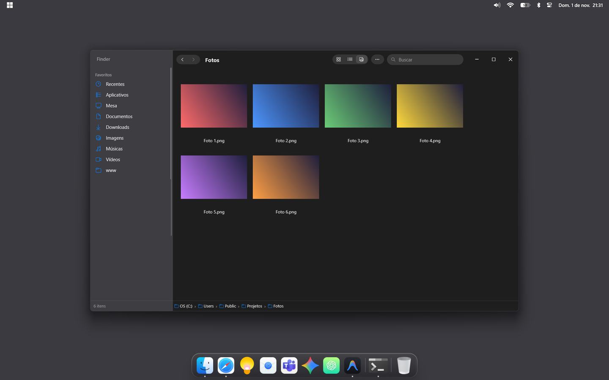

## Funcionalidades

### Dock

Vidro com desfoque (Liquid Glass), ícones que crescem sob o mouse e ponto nos apps abertos. Botão direito num app: *Manter na Dock*, *Não mostrar na Dock* e *Encerrar*; no fundo da dock: editar itens, Substituição de Texto, reiniciar e desligar o Mac Skin.

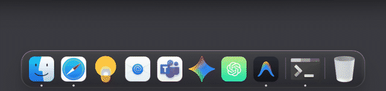

| Menu de um app | Menu da dock |
|---|---|
| 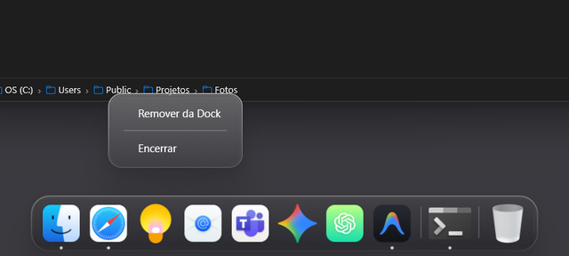 | 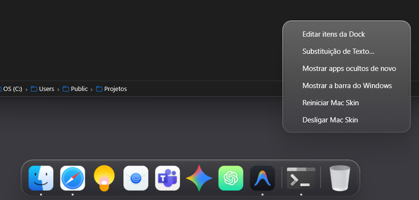 |

### Barra de menus

Calendário no relógio, Bluetooth, Central de Controle com os apps em segundo plano (a bandeja do Windows) e indicador de volume em vidro, como no macOS.

| Calendário | Central de Controle |
|---|---|
| 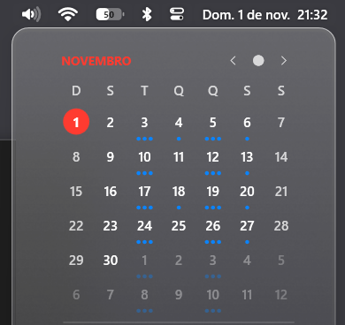 | 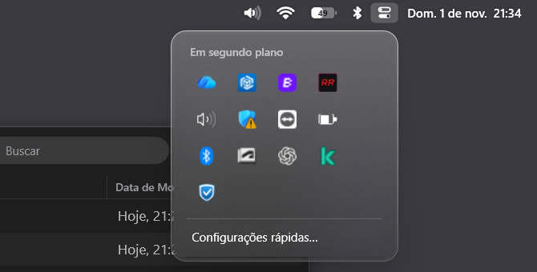 |

| Bluetooth | Volume |
|---|---|
| 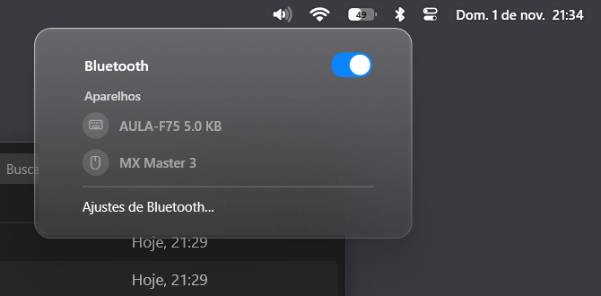 | 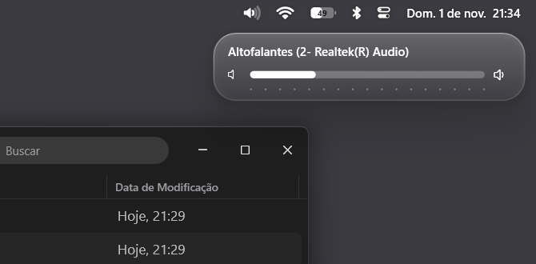 |

### Finder

Navegador de arquivos no visual do Finder, com arquivos de verdade do Windows: abas, voltar/avançar, busca, caminho editável e menu de contexto nativo do Windows (inclui *Compactar para...*).

Três modos de visualização: lista, ícones e galeria.

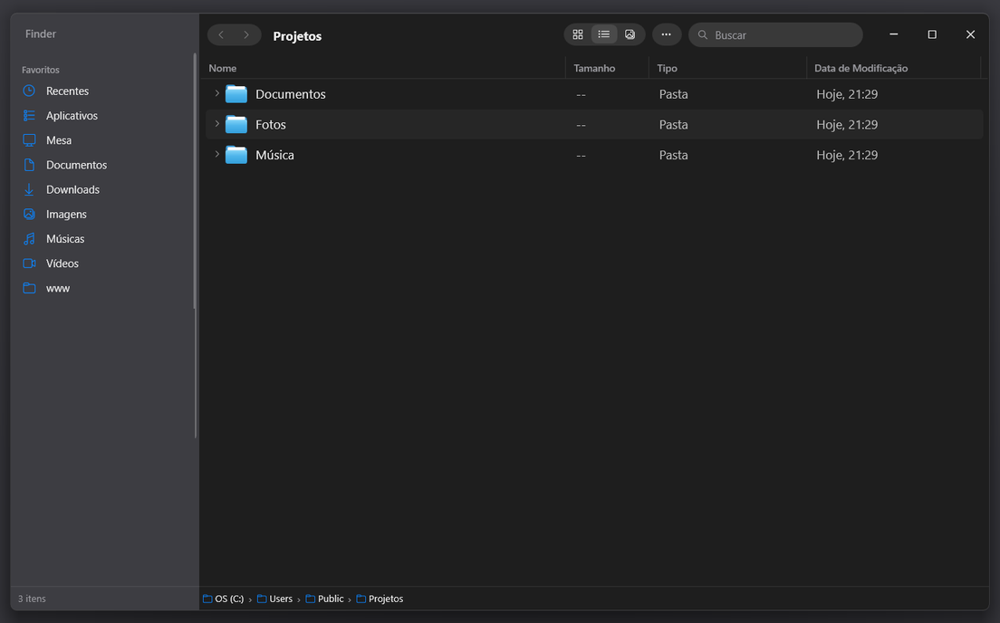
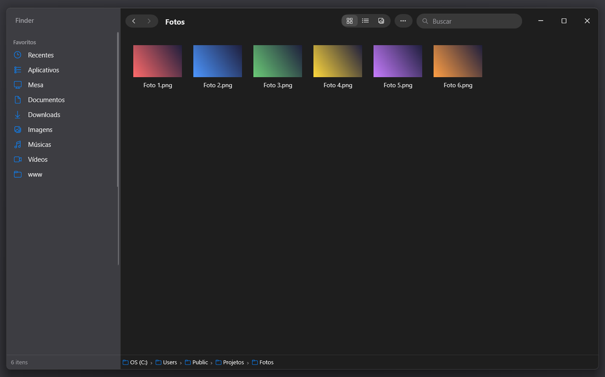
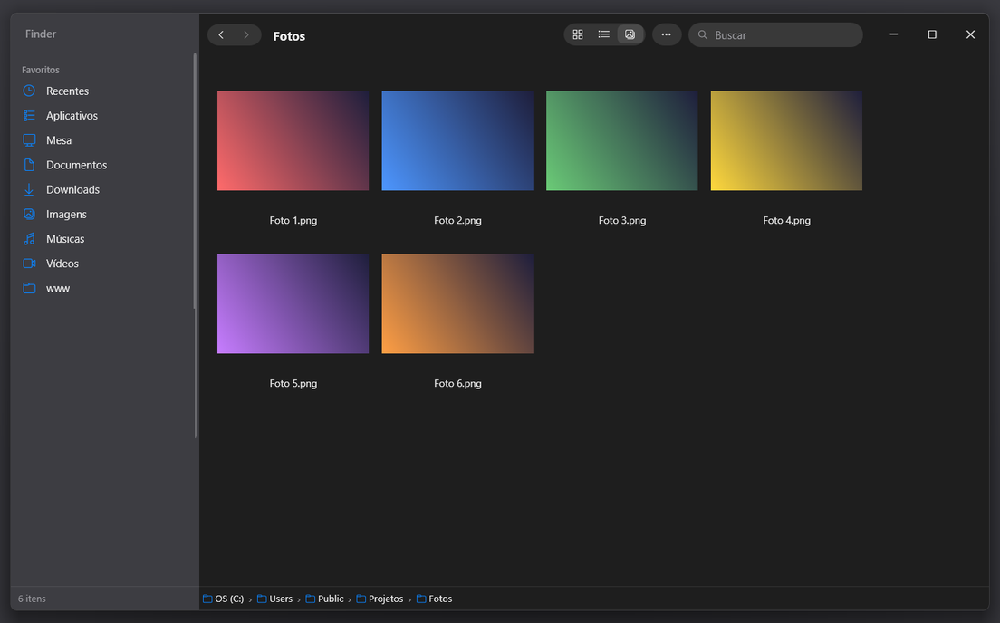

**Visualização Rápida:** a barra de espaço abre e fecha a prévia do item selecionado; as setas trocam de item e Esc fecha.

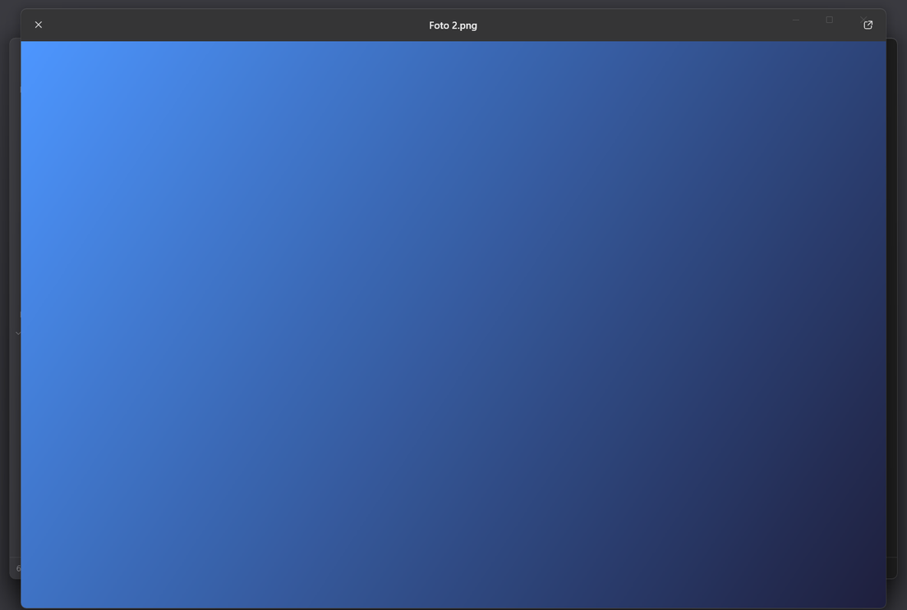

**Menu de contexto** com todas as extensões do sistema:

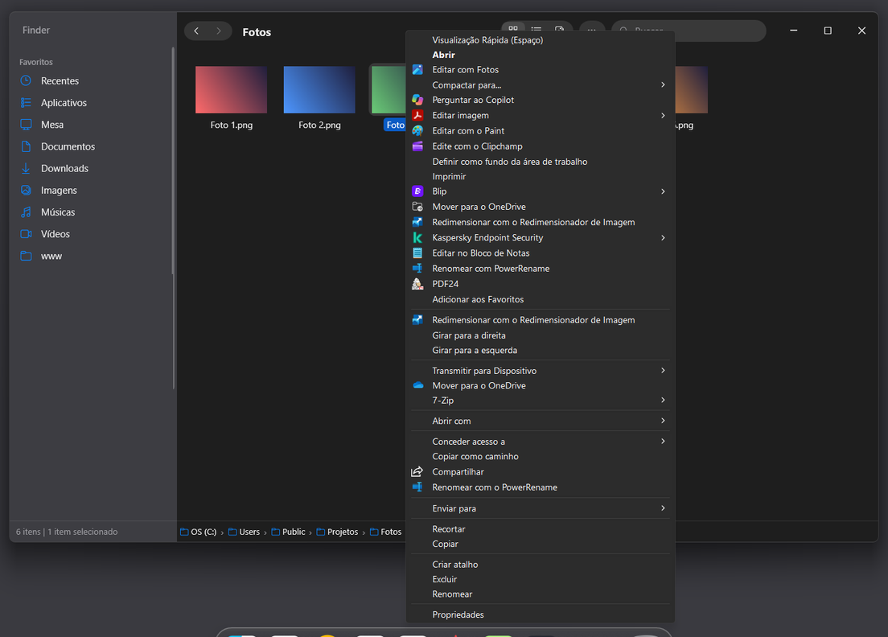

### Substituição de Texto

Digite um atalho (ex.: `@ass`) em qualquer app e ele vira o texto cadastrado, com campos como data, hora, dia da semana, área de transferência e posição do cursor. Abra em *botão direito na dock › Substituição de Texto…*. Tudo fica no seu computador.

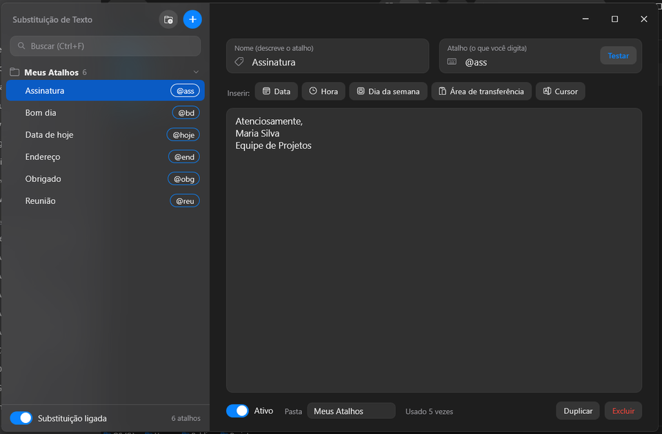

### Som de teclado

Cada tecla toca um clique de teclado mecânico, um ao descer e outro ao subir, com tom e volume um pouco diferentes a cada toque e do lado da tecla (esquerda/direita). Fica calado em campos de senha e em jogo ou apresentação em tela cheia. Liga na *Central de Controle* (ícone ao lado do relógio) ou com `Ctrl+Alt+K`. Três perfis próprios: Grafite (grave), Cristal (com clique) e Seda (discreto).

### Outros

- **Arrastar com 3 dedos** no touchpad de precisão, como no Mac (veja a seção abaixo).
- **Botões da janela:** minimizar fica amarelo e maximizar verde ao passar o mouse.
- **Abrir, salvar e escolher pasta** dos programas viram o Finder.
- **Confirmação de exclusão** em vidro, no lugar do diálogo do Explorador.
- **Janelas de pasta do Explorador** abrem no Finder; `.zip` descompacta ao lado, como no Mac.

## Gerar o instalador (num Mac)

```bash
brew install makensis
pip3 install Pillow
./build.sh            # gera MacSkin-Setup.exe
```

Os ícones e o papel de parede são **extraídos do macOS de quem compila** e não fazem parte deste repositório (são material da Apple). Por isso não há `.exe` pronto para baixar.

## Usar no Windows

1. Rode `MacSkin-Setup.exe` (não pede admin) e escolha os componentes.
2. Para desfazer: Iniciar › Mac Skin › Desinstalar, ou Configurações › Aplicativos.
3. Se algo falhar, o log fica em `%LOCALAPPDATA%\MacSkin\macskin.log`.

### Sem o `.exe` e sem Mac

Pré-requisitos: Windows 10/11, internet na primeira vez e Python 3 (Microsoft Store, sem admin). O `instalar.cmd` instala sozinho o resto (`pip install --user Pillow resvg-py`).

Dê dois cliques em `instalar.cmd`. Se `instalador/payload` não existir, ele gera com [payload-windows.py](instalador/scripts/payload-windows.py), usando projetos livres no lugar do material da Apple:

| Item | Fonte | Licença |
|---|---|---|
| Ícones | [WhiteSur icon theme](https://github.com/vinceliuice/WhiteSur-icon-theme) | GPL-3.0 |
| Papel de parede | [WhiteSur wallpapers](https://github.com/vinceliuice/WhiteSur-wallpapers) (Monterey claro/escuro) | MIT |
| Cursores | [apple_cursor](https://github.com/ful1e5/apple_cursor) | GPL-3.0 |
| Fonte | [Inter](https://rsms.me/inter/) | OFL |

Depois copia tudo para `%LOCALAPPDATA%\MacSkin`, cria os atalhos no Iniciar e aplica. Sem Python, aplica só a base. Para desfazer, use `desinstalar.cmd` ou Iniciar › Mac Skin › Desinstalar Mac Skin.

### Dock

[dock.ps1](instalador/dock.ps1) é uma dock própria em WPF, sem instalar nada: vidro com desfoque (estilo Liquid Glass do macOS Golden Gate), ícones que crescem sob o mouse, pulo ao abrir, ponto nos apps abertos, Lixeira e some em tela cheia. A barra do Windows passa a se esconder sozinha e a dock reserva o espaço dela. Os itens são atalhos em `%LOCALAPPDATA%\MacSkin\dock` (botão direito na dock › Editar itens da Dock).

### Barra de menus

[barra.ps1](instalador/barra.ps1) é a barra de cima, como no Mac: menu do sistema (Sobre, Configurações, Bloquear, Suspender, Reiniciar, Desligar), nome do app ativo, bateria, Wi-Fi, volume e relógio. Wi-Fi e volume abrem as configurações rápidas (Win+A); o relógio abre notificações e calendário (Win+N). O ícone da Central de Controle (os dois interruptores) abre a caixa dos apps em segundo plano, a mesma da setinha da bandeja do Windows: clique e botão direito funcionam como lá (o "Sair do Teams", por exemplo).

### Arquivos .zip

Como no Mac, abrir um `.zip` (duplo clique no Finder ou qualquer programa que abra o zip no Explorador) descompacta numa pasta ao lado, com o nome do zip, e a mostra selecionada no Finder. Se o zip tiver uma pasta só dentro, ela vem direto, sem pasta extra.

### Abrir, salvar e escolher pasta

As caixas "Abrir", "Salvar como" e "Selecionar pasta" dos programas (Antigravity, VS Code, Edge, Office...) viram o Finder, com uma barra embaixo para escolher, cancelar ou voltar à caixa do Windows. O caminho escolhido é devolvido à caixa original, então o programa recebe a resposta normalmente ([Escolha.cs](app/Escolha.cs)). Para desligar a troca, crie o arquivo `caixas-nativas` em `%LOCALAPPDATA%\MacSkin`; o log fica em `escolha.log`.

### Arrastar com 3 dedos

Como no Mac: encoste 3 dedos no touchpad de precisão e deslize para mover janelas, arrastar arquivos e selecionar texto, sem apertar o touchpad. Ao tirar os dedos há 300 ms de tolerância: recolocando os 3 dedos nesse tempo, o mesmo arrasto continua. Tocar com 3 dedos sem mover não faz nada ([Arrastar3Dedos.cs](app/Arrastar3Dedos.cs)). Roda numa thread própria do Mac Skin, então o programa avulso Arrastar3dedos não deve rodar junto (o `instalar.cmd` o encerra e tira do início com o Windows). Em *Configurações › Bluetooth e dispositivos › Touchpad*, deixe "Passar o dedo" e "Toques" de 3 dedos em *Nada*. Para ajustar, crie `arrastar3dedos.txt` em `%LOCALAPPDATA%\MacSkin` com as linhas `velocidade=1.5`, `tolerancia=300` ou `desligado`; o log fica em `arrastar3dedos.log`.

[vigia.ps1](instalador/vigia.ps1) abre a dock e a barra a cada login e reabre o que fechar. Na raiz: `Tema claro.cmd`, `Tema escuro.cmd`, `Desligar Mac Skin.cmd` (fecha dock e barra, inclusive após reiniciar) e `Ligar Mac Skin.cmd`.

### Som de teclado

Começa sempre desligado quando o Mac Skin abre. Na Central de Controle: chave liga/desliga, volume, perfil (▶ toca uma prévia) e *Mais opções* (Shift/Ctrl/Alt/Win, clique do mouse, rolagem, pausa em tela cheia, som espacial, variação de tom, saída de áudio e a contagem de teclas do dia). Os ajustes ficam em `%APPDATA%\Mac Skin Dados\som-teclado.txt` e não somem ao desinstalar ([SomTeclado.cs](app/SomTeclado.cs), saída de áudio de baixa latência em [Wasapi.cs](app/Wasapi.cs)). Os sons são sintetizados pelo próprio programa. Para usar gravações suas ou de licença livre, abra *Mais opções › Pasta de sons…*: há um `LEIA-ME.txt` com o formato (`comum-desce-1.wav`, `espaco-desce-1.wav`...). Sem som em campo de senha: caixas do Windows, WPF e navegadores (Edge, Chrome, Brave, Opera, Vivaldi); apps Electron como o VS Code não são consultados, para não ligarem o modo de leitor de tela. Para editar os sons: botão direito na Dock › *Som de Teclado…* (ou *Mais opções › Editar sons…*). Lá dá para mudar tom, corpo, clique, brilho, duração e o som ao soltar, ajustar o volume de cada tipo de tecla (ouvindo com ▶) e criar perfis seus; tudo grava na hora em `%APPDATA%\Mac Skin Dados\sons-editados` ([SomTecladoEditor.cs](app/SomTecladoEditor.cs)). Bateria de testes: `MacSkin.exe --testar-som-teclado [relatório.txt]`; o log fica em `som-teclado.log`.

### Tema

O padrão é o modo escuro fixo. Iniciar › Mac Skin › Modo claro / Modo escuro trocam e lembram a escolha (`tema.txt`); `macskin.ps1 -Acao automatico` volta ao 07h claro / 19h escuro. O Office passa a seguir o tema do Windows.

Papel de parede definido por política da empresa (`Policies\System\Wallpaper`) prevalece e não é alterado.

O planejamento completo, incluindo o que dá e o que não dá para fazer sem admin, está em [fase-1-passo-a-passo.md](fase-1-passo-a-passo.md).

## Arquivos

| Arquivo | Função |
|---|---|
| `instalador/macskin.ps1` | Aplica, remove e troca o tema (claro/escuro/auto), com backup de tudo |
| `instalador/macskin.nsi` | Instalador NSIS por usuário, com desinstalador |
| `instalador/dock.ps1` | Dock no estilo macOS com Liquid Glass |
| `instalador/scripts/*.swift` | Extraem ícones e wallpaper do macOS |
| `instalador/scripts/payload-windows.py` | Monta o payload no Windows com ícones e wallpaper livres |
| `instalador/teste-desktopini.ps1` | Teste da lógica de `desktop.ini` (aplicar, ser idempotente, restaurar) |
| `build.sh` | Monta tudo e compila o `.exe` |
| `instalar.cmd` / `desinstalar.cmd` | Instalam e removem sem o `.exe`, direto pelo `macskin.ps1` |
